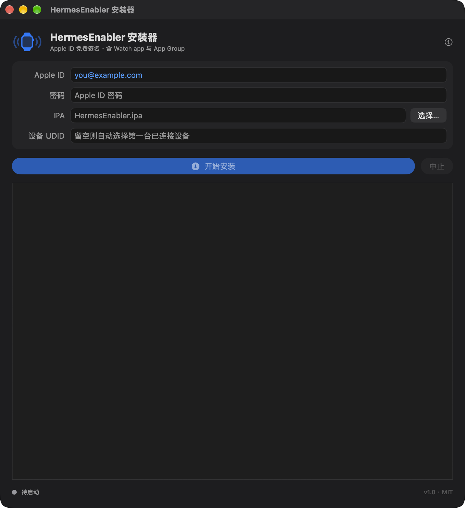

# HermesEnabler Installer

**English** · [简体中文](README.zh-CN.md)

A macOS GUI that signs **HermesEnabler** with a free Apple ID and installs it —
including its Apple Watch app with a proper **App Group** entitlement — onto a
paired iPhone and Apple Watch.



It exists because every tool currently in use fails at one specific point:

| Tool | Where it breaks |
|---|---|
| Sideloadly (free account) | never puts the Watch UDID in the profile, never handles Watch apps |
| AltStore / SideStore | Watch UDID missing → `0xe8008015` |
| Xcode (free team) | refuses `com.apple.security.application-groups` for free teams |
| upstream `isideload` | **skips the Watch app** when associating App Groups |

This project patches the last one and then uses two independent install paths —
`installation_proxy` for the phone, `devicectl` for the Watch — so it does not
depend on the phone exposing the legacy companion-proxy service.

> Modifying MobileGestalt is an unofficial change. Use at your own risk.
> Not affiliated with Apple Inc.

---

## Install (end users)

1. Download `HermesEnabler-Installer-1.0.dmg` from [Releases](../../releases)
2. Open it, drag the app to `Applications`
3. **First launch**: right-click the app → **Open** → **Open**
   (ad-hoc signed, so Gatekeeper asks once; or `xattr -cr /Applications/HermesEnabler.app`)
4. Download the IPA from [pookjw/HermesEnabler/releases](https://github.com/pookjw/HermesEnabler/releases)
5. Fill in your Apple ID, pick the IPA, click **开始安装 / Install**
6. Enter the 6-digit 2FA code when asked
7. When it finishes:
   - iPhone: **Settings → General → VPN & Device Management → Apple Development: you@… → Trust**
   - iPhone: **Watch app → My Watch → Available Apps → HermesEnabler → Install**
8. On the Watch: open HermesEnabler → **Backup MG** *before* changing anything

## Requirements

- macOS 13+
- Xcode or Xcode Command Line Tools (`xcrun` must work)
- Apple ID (free is enough)
- iPhone with Developer Mode, connected by USB and trusted
- Apple Watch paired to that iPhone, Developer Mode enabled
- Reachable Apple endpoints: `gsa.apple.com`, `idmsa.apple.com`,
  `developerservices2.apple.com`, plus an anisette server
  (default `https://ani.stikstore.app`)

If those domains are blocked, they need a working proxy — otherwise login or
`listTeams` dies with `tls handshake eof`.

## Known limits

- Free certificate expires in **7 days**; re-run the installer to renew. The
  Bundle ID is stable, so app data survives.
- A free account holds only **one** development certificate. Hitting `7460`
  makes the installer revoke the old one — apps signed with it stop launching.
- Never run **Backup MG** twice after a modification: it would overwrite the
  clean backup with the modified state.
- Watch face edits may need a Watch restart before they stick.

## Build from source

```bash
cargo build --release                 # CLI
./scripts/build.sh                    # CLI + GUI + .app
./scripts/make-dmg.sh                 # dist/*.dmg
```

Layout:

```
src/main.rs          CLI: login → sign → install
gui/main.swift       SwiftUI shell around the CLI
vendor/isideload/    patched isideload 0.3.17
scripts/build.sh     assembles HermesEnabler.app
scripts/make-dmg.sh  builds the DMG
assets/AppIcon.icns  icon (SF Symbol applewatch.radiowaves.left.and.right)
docs/PATCHES.md      what was changed in isideload and why
```

## The two upstream patches

See [docs/PATCHES.md](docs/PATCHES.md). Summary:

1. **`anisette/remote_v3/mod.rs`** — `client_info` now comes from the anisette
   server's `/v3/client_info` instead of a hardcoded macOS string. Apple has
   rejected mismatched anisette client info since 2026-10-12.
2. **`sideload/sideloader.rs`** — the Watch app is no longer skipped in the App
   Group association loop; it is assigned with `DeveloperDeviceType::Watchos`.

## A note from the author

This project was built with AI assistance. The author is new to this kind of
tooling and has essentially no experience with pull requests or open-source
process. It works on the author's own setup (iPhone 17 Pro + Apple Watch,
watchOS 27), but please judge the risks yourself before using it. Issues and
corrections are very welcome.

## License

MIT — see [LICENSE](LICENSE). Linked crates and their SPDX identifiers are in
[THIRD_PARTY_LICENSES.md](THIRD_PARTY_LICENSES.md).

Upstream: [HermesEnabler](https://github.com/pookjw/HermesEnabler) (MIT),
[iloader](https://github.com/nab138/iloader) (MIT),
[isideload](https://github.com/nab138/isideload) (MIT).
